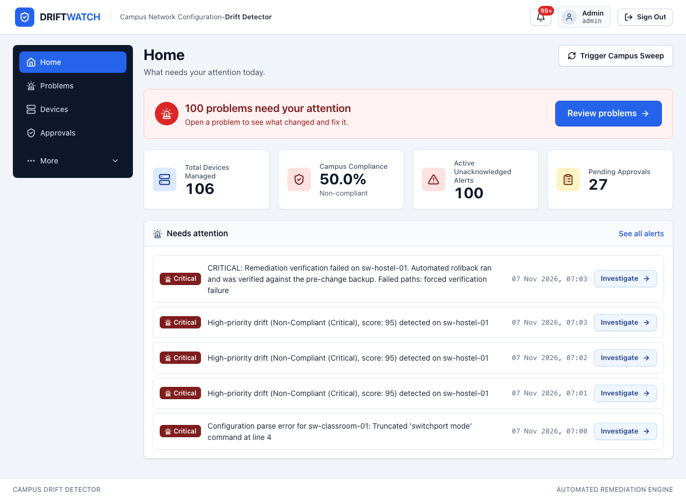
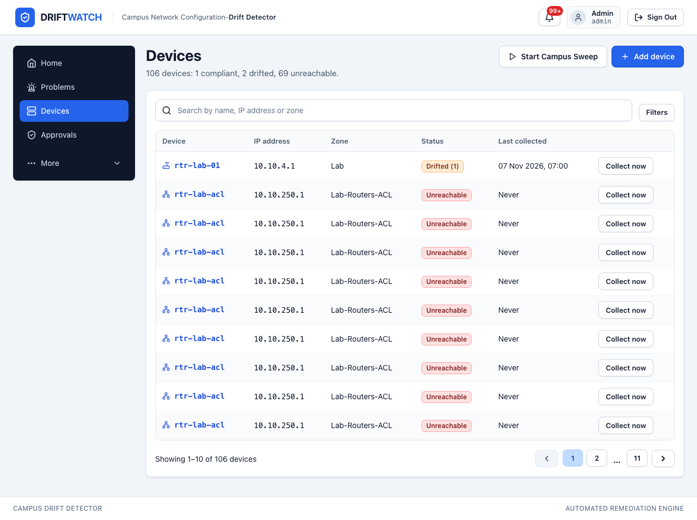
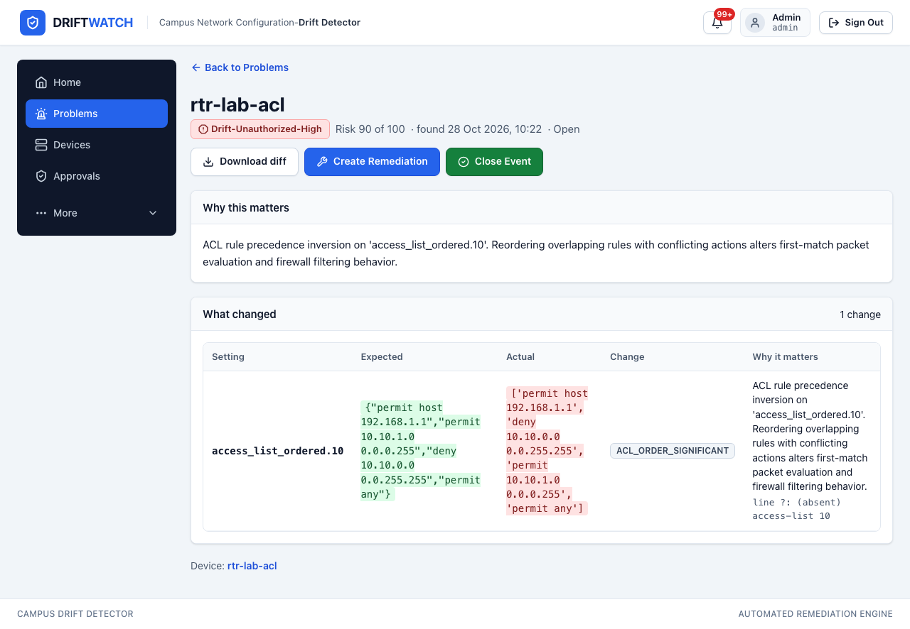
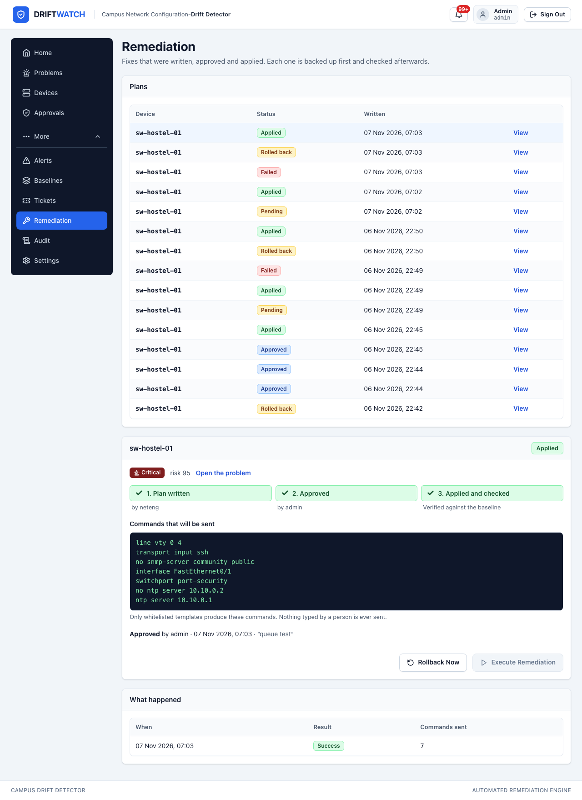
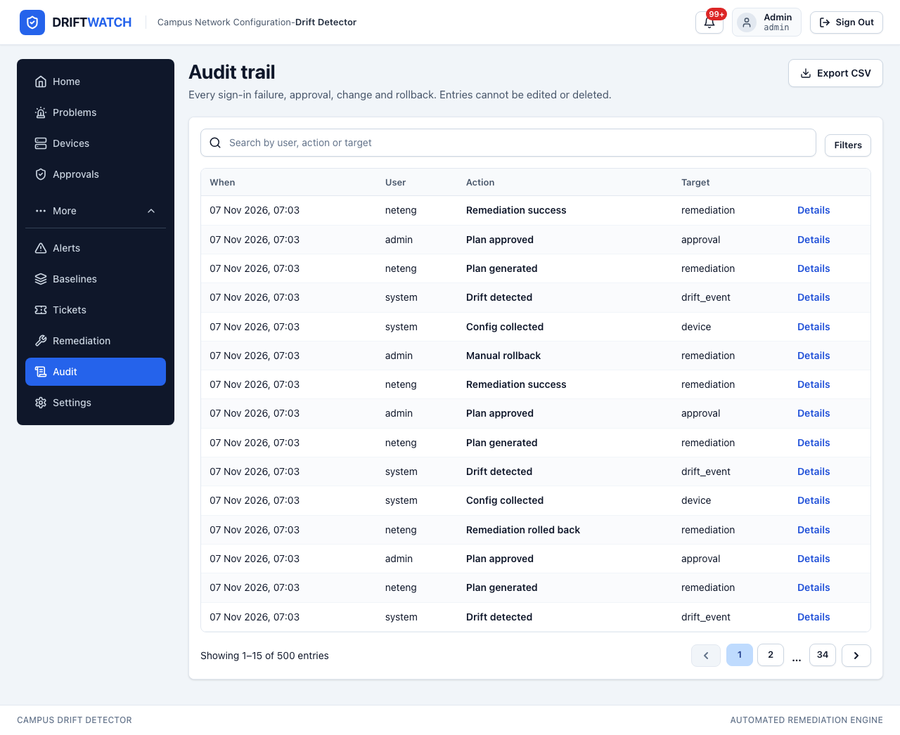
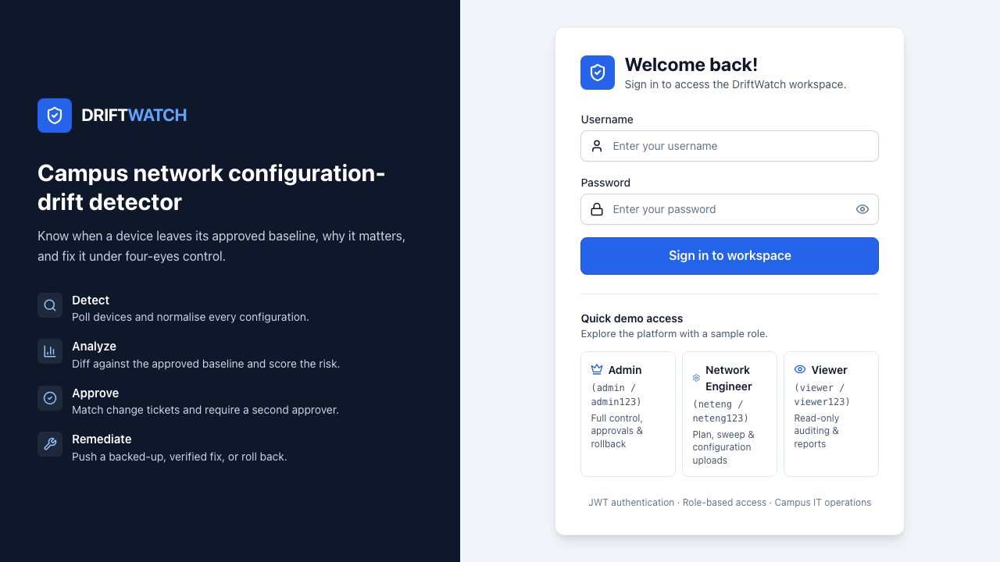
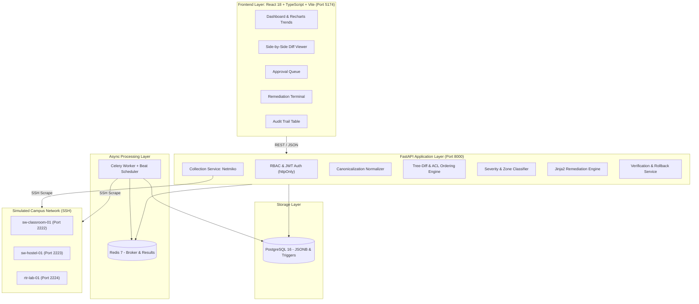
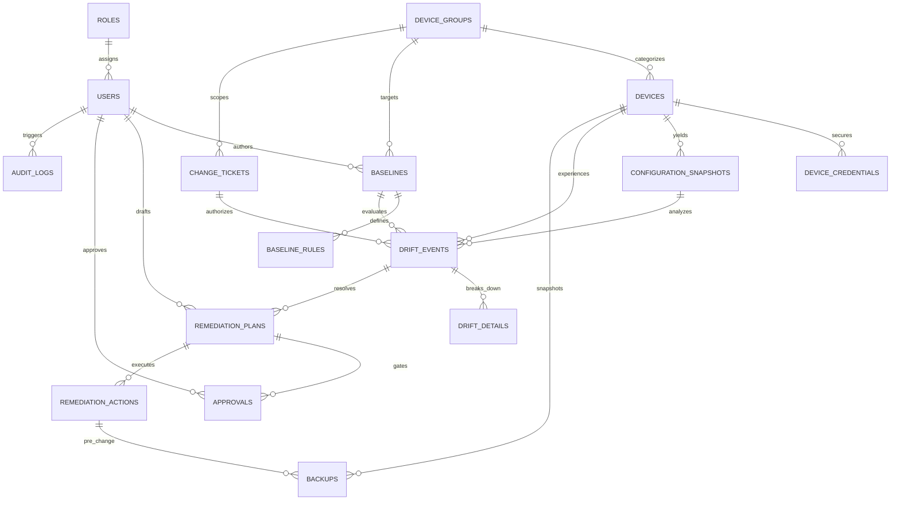

# Campus Network Configuration-Drift Detector

[](https://www.python.org/)
[](https://fastapi.tiangolo.com/)
[](https://react.dev/)
[](https://www.typescriptlang.org/)
[](https://www.postgresql.org/)
[](https://redis.io/)
[](https://www.docker.com/)
[](backend/tests/)
[](LICENSE)

An enterprise-grade, automated network configuration-drift detection and remediation platform designed for decentralized campus environments (academic lecture halls, student hostels, research laboratories, and administrative offices).

---

## Table of Contents

- [What the Project Does](#what-the-project-does)
- [Why the Project is Useful](#why-the-project-is-useful)
- [Feature Walkthrough & Screenshots](#feature-walkthrough--screenshots)
- [Architecture & Tech Stack](#architecture--tech-stack)
- [Database Schema Reference](#database-schema-reference)
- [API Endpoint Reference](#api-endpoint-reference)
- [Unit Testing & Error Boundaries](#unit-testing--error-boundaries)
- [How to Get Started](#how-to-get-started)
  - [Prerequisites](#prerequisites)
  - [Quickstart with Docker Compose](#quickstart-with-docker-compose)
  - [Pre-Seeded Demo Credentials](#pre-seeded-demo-credentials)
  - [Local Development Setup](#local-development-setup)
  - [Running Automated Tests](#running-automated-tests)
- [Usage Examples & Workflow](#usage-examples--workflow)
  - [1. Defining a Golden Baseline](#1-defining-a-golden-baseline)
  - [2. Triggering Configuration Sweeps](#2-triggering-configuration-sweeps)
  - [3. Ingesting ITSM Change Tickets via Webhook](#3-ingesting-itsm-change-tickets-via-webhook)
  - [4. Generating & Applying Gated Remediation](#4-generating--applying-gated-remediation)
  - [5. Coexisting with a Legacy Workflow](#5-coexisting-with-a-legacy-workflow)
- [Where to Get Help & Documentation](#where-to-get-help--documentation)
- [Who Maintains & Contributes](#who-maintains--contributes)

---

## What the Project Does

In multi-tenant campus networks, switches and routers steadily deviate from security baselines due to ad-hoc troubleshooting during lectures, temporary lab setups, and unrecorded emergency tweaks. These unmanaged deviations ("configuration drift") introduce critical vulnerabilities:
- Insecure management protocols (e.g., Telnet re-enabled on access lines).
- Unauthorized SNMP community strings (`public`/`private`) exposed to student subnets.
- Disabled switchport security facilitating rogue access points and MAC-flooding attacks.
- NTP clock desynchronization compromising security incident forensics.
- Unauthorized VLAN assignments causing inter-VLAN leakage between isolated student, faculty, and administrative networks.

**Campus Drift Detector** continuously audits running network configurations against cryptographically verified golden baselines, scores deviations by risk and campus zone criticality, suppresses authorized changes within approved maintenance windows, and generates safe, templated CLI remediation commands with automated pre-change backups and rollback verification.

---

## Why the Project is Useful

- **Zero Free-Text Command Injection:** Network engineers cannot push arbitrary CLI strings. Remediations are generated exclusively through parameterized Jinja2 templates; any shell metacharacters (`;&|$\`\\`"`}) are rejected automatically with `HTTP 422`.
- **Semantic Normalization (Zero Cosmetic False Alarms):** Eliminates syntax-level false positives by canonicalizing CIDR subnet masks, interface names, whitespace ordering, boolean equivalents, and VLAN lists.
- **Semantic ACL Sequence Ordering & Overlap Analysis:** Evaluates pairwise IP subnet intersections to distinguish benign disjoint rule swaps from security-critical overlapping rule swaps.
- **Zone-Weighted Risk Scoring ($1 - 100$):** Multiplies severity by campus physical zone criticality (Research Lab $1.2\times$, Lecture Hall $1.0\times$, Hostel $0.8\times$, Public Event $0.5\times$).
- **Temporal Change Ticket Suppression ($\pm30$ min grace window):** Ingests ServiceNow/Jira tickets via HMAC-SHA256 authenticated webhooks, automatically suppressing alarms during planned maintenance.
- **Automated Backup & Rollback Safety Net:** Captures a pre-change running configuration snapshot, executes remediation, re-polls the device immediately, and triggers automated rollback if post-change verification fails.
- **Dual-Control Four-Eyes Gate:** The author of a remediation plan can never approve it (enforced server-side, audited); a different engineer or an Admin must approve before execution.
- **Immutable Append-Only Audit Trail:** Database triggers record tamper-resistant logs for all logins, baseline changes, approval decisions, sweeps, and rollbacks.
- **Simulated Campus Network Built-In:** Includes 3 containerized SSH switches with custom CLI emulators, enabling full end-to-end evaluation without physical hardware.

---

## Feature Walkthrough & Screenshots

### 1. Operational Overview Dashboard
*Real-time compliance gauge, active devices inventory breakdown, and 14-day drift trendline analytics.*


---

### 2. Campus Device Inventory
*Inventory view with physical campus zone weights, IP endpoints, credentials vault, and live polling triggers.*


---

### 3. Drift Detection & Side-by-Side Diff Viewer
*Structured rule-level comparison highlighting unauthorized deviations against golden baselines with unified diff inspection.*


---

### 4. Safe Remediation Terminal & Rollback Safety
*Jinja2-templated command preview, Admin peer sign-off gate, live execution, and automated rollback triggers.*


---

### 5. Immutable Append-Only Audit Trail
*Tamper-resistant database logs capturing every authentication attempt, configuration sweep, approval decision, and rollback.*


---

### 6. Role-Based Access Control (RBAC)
*Tiered authentication (Admin, Network Engineer, Viewer) featuring 1-click demo presets for evaluation.*


---

## Architecture & Tech Stack



| Component | Technologies | Primary Role |
| :--- | :--- | :--- |
| **Backend API** | FastAPI 0.115, Pydantic v2, Uvicorn | High-throughput asynchronous REST API |
| **Database** | PostgreSQL 16, SQLAlchemy 2.0, Alembic | Relational data, JSONB snapshots, and trigger audit logging |
| **Task Queue** | Redis 7, Celery 5.4 | Non-blocking periodic network polling sweeps |
| **Network Engine** | Netmiko 4.4, Paramiko | SSH CLI configuration pull, commit, and verification |
| **Templates** | Jinja2 3.1 | Safe, parameterized CLI remediation generation |
| **Frontend** | React 18, TypeScript 5.5, Vite 5.4 | Interactive Single Page Application (SPA) |
| **Styling** | Tailwind CSS 3.4, Lucide React | Responsive operational dashboard with dark-mode accents |
| **State & Data** | TanStack Query v5, Zustand v4 | Client-side data caching and session persistence |
| **Charts** | Recharts 2.12 | 14-day compliance and drift trendline analytics |
| **Testing** | pytest, pytest-asyncio, httpx | 267 automated unit and integration tests |

---

## Database Schema Reference

The database models are implemented using SQLAlchemy 2.0 with PostgreSQL 16 JSONB support and SQLite-compatible migrations (`backend/app/models/`). The schema consists of 17 core relational tables:



### Table Specifications

| Table Name | Primary Key | Foreign Keys | Key Attributes & Business Role |
| :--- | :--- | :--- | :--- |
| `roles` | `id: CHAR(32)` | - | `name` (VARCHAR 32, UNIQUE: `admin`, `neteng`, `viewer`). RBAC role definitions. |
| `users` | `id: CHAR(32)` | `role_id -> roles.id` | `username` (VARCHAR 64), `password_hash` (VARCHAR 255), `is_active` (BOOL). System users. |
| `device_groups` | `id: CHAR(32)` | - | `name` (VARCHAR 64), `criticality_weight` (FLOAT: Lab 1.2, Classroom 1.0, Hostel 0.8, Event 0.5). |
| `devices` | `id: CHAR(32)` | `device_group_id -> device_groups.id` | `hostname`, `ip_address`, `vendor`, `model`, `status`, `collection_mode`, `shadow_mode`. |
| `device_credentials`| `id: CHAR(32)` | `device_id -> devices.id` | `username_enc` (BLOB), `secret_ref` (VARCHAR), `auth_type` (`SSH_KEY`/`PASSWORD`). |
| `baselines` | `id: CHAR(32)` | `device_group_id`, `created_by` | `name`, `vendor`, `version` (INT), `is_active` (BOOL). Golden configuration baselines. |
| `baseline_rules` | `id: CHAR(32)` | `baseline_id -> baselines.id` | `key_path`, `expected_value`, `rule_type`, `severity_weight` (1-100), `hard_compliance`. |
| `configuration_snapshots` | `id: CHAR(32)` | `device_id -> devices.id` | `raw_config` (TEXT), `normalized_json` (JSON), `collected_at`, `collection_method`, `status`. |
| `change_tickets` | `id: CHAR(32)` | `device_id`, `device_group_id` | `ticket_ref`, `source`, `external_ref`, `key_path_scope`, `valid_from`, `valid_to`, `status`. |
| `drift_events` | `id: CHAR(32)` | `device_id`, `snapshot_id`, `baseline_id`, `matched_ticket_id` | `label`, `risk_score` (1-100), `underlying_severity`, `status` (`OPEN`, `REMEDIATED`). |
| `drift_details` | `id: CHAR(32)` | `drift_event_id`, `rule_id` | `key_path`, `expected_value`, `actual_value`, `change_type` (`ADDED`/`REMOVED`/`MODIFIED`). |
| `remediation_plans`| `id: CHAR(32)` | `drift_event_id`, `created_by` | `proposed_commands` (JSON), `status` (`DRAFT`, `APPROVED`, `APPLIED`, `FAILED`). |
| `approvals` | `id: CHAR(32)` | `remediation_plan_id`, `approved_by` | `decision` (`APPROVED`/`REJECTED`), `comment`, `decided_at`. Dual-control four-eyes gate. |
| `remediation_actions` | `id: CHAR(32)` | `remediation_plan_id`, `verification_snapshot_id` | `executed_commands` (JSON), `result` (`SUCCESS`, `ROLLED_BACK`, `ROLLBACK_FAILED`, `ABORTED`). |
| `backups` | `id: CHAR(32)` | `device_id`, `taken_before_action_id` | `config_blob` (TEXT), `taken_at`. Pre-change configuration snapshot before any push. |
| `alerts` | `id: CHAR(32)` | `related_id` | `type` (`CRITICAL_DRIFT`, `DEVICE_DOWN`), `message`, `acknowledged` (BOOL), `created_at`. |
| `audit_logs` | `id: CHAR(32)` | `user_id -> users.id` | `action`, `target_type`, `target_id`, `before_state` (JSON), `after_state` (JSON), `timestamp`. |

---

## API Endpoint Reference

The REST API provides 37 secure endpoints built on FastAPI with automated OpenAPI/Swagger documentation (`http://localhost:8000/docs`).

| Domain | Method | Endpoint Path | Role Required | Description & Status Codes |
| :--- | :--- | :--- | :--- | :--- |
| **System** | `GET` | `/health`, `/api/health` | Public | Liveness and database/Redis readiness probes (`200 OK`). |
| **Auth** | `POST` | `/api/auth/login` | Public | Authenticates credentials; returns JWT token and sets httpOnly cookie (`200`, `401`). |
| **Auth** | `POST` | `/api/auth/refresh` | Public | Refreshes session JWT via refresh token cookie (`200`, `401`). |
| **Auth** | `GET` | `/api/auth/me` | Viewer+ | Retrieves profile, permissions, and active role for current user (`200`, `401`). |
| **Auth** | `POST` | `/api/auth/logout` | Viewer+ | Invalidates session and clears authentication cookies (`200`). |
| **Devices** | `GET` | `/api/devices` | Viewer+ | Lists network devices filtered by zone, vendor, or status (`200`). |
| **Devices** | `GET` | `/api/devices/groups` | Viewer+ | Lists campus physical device groups and zone criticality weights (`200`). |
| **Devices** | `POST` | `/api/devices` | Admin | Registers a new campus device into inventory (`201`, `422`). |
| **Devices** | `GET` | `/api/devices/{device_id}` | Viewer+ | Retrieves device metadata, IP address, and last polled timestamp (`200`, `404`). |
| **Devices** | `PUT` | `/api/devices/{device_id}` | Admin | Updates device network settings, vendor, or zone group (`200`, `404`). |
| **Devices** | `DELETE`| `/api/devices/{device_id}` | Admin | Decommissions device and cascades configuration history (`204`, `404`). |
| **Devices** | `POST` | `/api/devices/{device_id}/credentials` | Admin | Sets encrypted SSH credentials via AES/Fernet envelope (`201`, `403`). |
| **Devices** | `POST` | `/api/devices/{device_id}/poll` | NetEng+ | Enqueues async Celery task to scrape running-config over SSH (`202`, `409`). |
| **Devices** | `GET` | `/api/devices/{device_id}/poll-status/{task_id}` | Viewer+ | Queries Celery task state and completion results (`200`, `404`). |
| **Devices** | `POST` | `/api/devices/{device_id}/config-upload` | NetEng+ | Ingests offline running-config for air-gapped / legacy devices (`201`, `422`). |
| **Devices** | `PUT` | `/api/devices/{device_id}/collection-mode` | Admin | Toggles between `SSH_SCRAPE` / `MANUAL_UPLOAD` and shadow mode (`200`). |
| **Baselines** | `GET` | `/api/baselines` | Viewer+ | Lists all golden baselines with version history and active status (`200`). |
| **Baselines** | `POST` | `/api/baselines` | NetEng+ | Creates declarative baseline with structured key-path rules (`201`, `422`). |
| **Baselines** | `GET` | `/api/baselines/{baseline_id}` | Viewer+ | Retrieves baseline details and associated device group (`200`, `404`). |
| **Baselines** | `GET` | `/api/baselines/{baseline_id}/rules` | Viewer+ | Lists compliance rules, regex patterns, and severity weights (`200`). |
| **Baselines** | `PUT` | `/api/baselines/{baseline_id}/activate` | Admin | Atomically activates baseline version as the golden standard (`200`, `403`). |
| **Tickets** | `GET` | `/api/tickets` | Viewer+ | Queries change tickets filtered by device or active window (`200`). |
| **Tickets** | `POST` | `/api/tickets` | NetEng+ | Creates planned change ticket with start/end maintenance window (`201`). |
| **Tickets** | `POST` | `/api/tickets/webhook` | External (HMAC) | Ingests ServiceNow/Jira change tickets verified via HMAC-SHA256 (`200`, `401`, `422`). |
| **Drift** | `GET` | `/api/drift` | Viewer+ | Lists drift events with risk scores, campus zone weight, and labels (`200`). |
| **Drift** | `GET` | `/api/drift/{drift_id}` | Viewer+ | Returns full evidence bundle, side-by-side diffs, and source line numbers (`200`). |
| **Drift** | `POST` | `/api/drift/{drift_id}/mark-false-positive` | NetEng+ | Classifies drift as intentional/reviewed false positive with audit trail (`200`). |
| **Remediation** | `GET` | `/api/remediation` | Viewer+ | Lists remediation plans, generated CLI commands, and execution status (`200`). |
| **Remediation** | `POST` | `/api/remediation/{drift_id}/generate-plan` | NetEng+ | Generates templated CLI commands using whitelisted Jinja2 templates (`201`, `422`). |
| **Remediation** | `GET` | `/api/remediation/{plan_id}` | Viewer+ | Retrieves command script, pre-change diffs, and verification steps (`200`). |
| **Remediation** | `POST` | `/api/remediation/{plan_id}/apply` | NetEng+ | Executes approved plan with pre-change backup and rollback safety (`200`, `409`). |
| **Remediation** | `POST` | `/api/remediation/{plan_id}/rollback` | Admin | Manually triggers restoration of pre-change backup on target device (`200`, `500`). |
| **Approvals** | `GET` | `/api/approvals/pending` | Admin | Lists remediation plans awaiting dual-control peer approval (`200`). |
| **Approvals** | `POST` | `/api/approvals/{plan_id}` | Admin | Approves or rejects plan with four-eyes enforcement: author cannot approve (`200`, `403`). |
| **Alerts** | `GET` | `/api/alerts` | Viewer+ | Retrieves real-time alerts for critical drift and device connectivity (`200`). |
| **Alerts** | `POST` | `/api/alerts/{alert_id}/ack` | NetEng+ | Acknowledges an active operational alert (`200`, `404`). |
| **Audit** | `GET` | `/api/audit` | Viewer+ | Queries immutable append-only audit trail by user, action, and timestamp (`200`). |
| **Dashboard** | `GET` | `/api/dashboard/summary` | Viewer+ | Aggregates campus compliance percentage, active alerts, and 14-day trends (`200`). |

---

## Unit Testing & Error Boundaries

For complete architectural specifications, see the dedicated guide: **[docs/testing-and-error-boundaries.md](docs/testing-and-error-boundaries.md)**.

### Testing Architecture Summary

The repository provides a three-tiered testing strategy guaranteeing deterministic, offline validation:
1. **Unit Testing Purity (237 Tests - 100% Passing in ~22s):** Runs completely offline using an in-memory SQLite fixture (`sqlite:///:memory:`) and eager in-memory Celery broker (`memory://`), completely isolated from physical PostgreSQL or Redis servers.
2. **Integration Testing (30 Tests):** Validates Celery async task dispatch, live SSH interaction with containerized switches, PostgreSQL transactional advisory locking, and end-to-end rollback verification.
3. **Frontend Quality & E2E Testing:** Playwright automated test suite (`frontend/e2e/dashboard-workflows.spec.ts`) validating 6 core dashboard workflows (Authentication, Metrics, Devices, Drift, Four-Eyes Approvals, and Audit Trail).

### Test & Linter Execution Commands

```bash
# 1. Run All 237 Offline Unit Tests (Zero External Services Needed)
PYTHONPATH=backend ./.venv/bin/pytest backend/tests/unit -v

# 2. Run Integration Tests (Requires Docker Stack)
PYTHONPATH=backend ./.venv/bin/pytest backend/tests/integration -v

# 3. Run Backend Python Linter (Ruff PEP8 & Typing Compliance)
./.venv/bin/ruff check backend

# 4. Run Frontend TypeScript Linter (ESLint Zero Warnings)
cd frontend && npm run lint

# 5. Run Automated Pre-Commit Pipeline (Ruff + Pytest + ESLint + Vite Build)
./scripts/pre_commit.sh

# 6. Run Playwright E2E UI Tests
cd frontend && npm run test:e2e
```

### Architectural Error Boundaries

The application enforces 5 resilient error boundaries:
1. **Network & Protocol Boundary:** SSH timeouts (10s) and authentication failures cleanly catch `NetmikoBaseException`, transition device to `UNREACHABLE`, trigger `DEVICE_DOWN` alerts, and preserve historical configuration snapshots.
2. **Concurrency & Advisory Locks:** Employs PostgreSQL transactional advisory locks (`pg_try_advisory_xact_lock`) preventing race conditions during simultaneous polling sweeps and remediation changes.
3. **Security & Input Validation:** Zero user-supplied CLI; strictly parameterized Jinja2 templates. Shell metacharacters (`;&|$\`\\\"`) trigger `HTTP 422 Unprocessable Content` with `SecurityViolationError`. ITSM webhooks authenticated via constant-time HMAC-SHA256 (`HTTP 401` on mismatch).
4. **Dual-Control Four-Eyes Gate:** Plan author can never approve their own plan (`HTTP 403 Forbidden`). Every decision is logged to the immutable audit trail.
5. **Remediation & Automated Rollback:** Captures mandatory pre-change snapshot before pushing commands. If post-change verification fails, restores backup over a fresh SSH connection, re-verifies byte-level equality, and records `ROLLED_BACK`. If unprovable, flags `ROLLBACK_FAILED` for emergency dispatch.

---

## How to Get Started

### Prerequisites

- [Docker](https://docs.docker.com/get-docker/) (v24.0+) & [Docker Compose](https://docs.docker.com/compose/) (v2.0+)
- Python 3.9+ (optional, for local non-container development)
- Node.js 18+ & npm (optional, for local frontend development)

### Quickstart with Docker Compose

1. **Clone the repository:**
   ```bash
   git clone https://github.com/NitikasriJeyanAchary0109/campus-drift.git
   cd campus-drift
   ```

2. **Configure environment variables:**
   ```bash
   cp .env.example .env
   ```
   *(If port `5432` is occupied on your host, set `POSTGRES_PORT=5433` in `.env`)*

3. **Launch the entire stack:**
   ```bash
   docker compose up --build -d
   ```

4. **Access the application:**
   - **Web UI:** [http://localhost:5174](http://localhost:5174) (or `http://localhost:5173` depending on `.env`)
   - **Interactive API Documentation (Swagger):** [http://localhost:8000/docs](http://localhost:8000/docs)
   - **Alternative ReDoc Docs:** [http://localhost:8000/redoc](http://localhost:8000/redoc)
   - **Backend Health Check:** [http://localhost:8000/api/health](http://localhost:8000/api/health)

### Pre-Seeded Demo Credentials

The database is pre-seeded with three demo role accounts for instant testing:

| Role | Username | Password | Access Level |
| :--- | :--- | :--- | :--- |
| **Admin** | `admin` | `admin123` | Full access: approve remediation, trigger rollbacks, activate baselines |
| **Network Engineer** | `neteng` | `neteng123` | Draft baselines, generate remediation plans, trigger device polling |
| **Viewer** | `viewer` | `viewer123` | Read-only access to dashboard, devices, drift diffs, and audit logs |

> **Tip:** The login screen includes 1-click **Demo Role Preset buttons** to sign in instantly without typing credentials.

### Local Development Setup

If running natively on your host machine without Docker:

```bash
# 1. Setup Backend Python Environment
python3 -m venv .venv
source .venv/bin/activate
pip install -r backend/requirements.txt

# 2. Run Database Migrations & Seed
cd backend
alembic upgrade head
python ../database/seed/seed_data.py

# 3. Start Backend Server
uvicorn app.main:app --host 0.0.0.0 --port 8000 --reload

# 4. Setup & Start Frontend (in a new terminal)
cd ../frontend
npm install
npm run dev
```

### Running Automated Tests

Run the complete 267-test suite covering parsers, diffing logic, security guardrails, Celery tasks, and SSH rollback flows:

```bash
# From project root (with postgres & redis running)
pytest backend/tests -v
```

```text
================== 267 passed, 4 warnings in ~80s ==================
```

---

## Usage Examples & Workflow

### 1. Defining a Golden Baseline

Baselines are managed declaratively via JSON or YAML definitions (`POST /api/baselines`):

```yaml
name: "Hostel-Edge-Baseline-v1"
device_group: "Hostel"
vendor: "cisco_ios"
rules:
  - key_path: "line.vty.transport_input"
    expected_value: "ssh"
    rule_type: "EXACT"
    severity_weight: 90
    hard_compliance: true

  - key_path: "snmp.community.public.exists"
    expected_value: "false"
    rule_type: "MUST_NOT_EXIST"
    severity_weight: 95
    hard_compliance: true

  - key_path: "interface.FastEthernet0/1.port_security.enabled"
    expected_value: "true"
    rule_type: "EXACT"
    severity_weight: 70
    hard_compliance: false

  - key_path: "ntp.server"
    expected_value: "10.10.0.1"
    rule_type: "EXACT"
    severity_weight: 20
    hard_compliance: false
```

### 2. Triggering Configuration Sweeps

Poll all devices across all campus zones asynchronously via Celery:

```bash
curl -X POST http://localhost:8000/api/devices/sweep/all \
  -H "Authorization: Bearer <NETENG_OR_ADMIN_TOKEN>"
```

### 3. Ingesting ITSM Change Tickets via Webhook

ServiceNow or Jira changes can be posted with HMAC-SHA256 signature verification to suppress planned maintenance alerts:

```bash
curl -X POST http://localhost:8000/api/tickets/webhook \
  -H "Content-Type: application/json" \
  -H "X-ITSM-Signature: sha256=<HMAC_SIGNATURE>" \
  -d '{
    "external_ref": "CHG0098231",
    "source": "ServiceNow",
    "hostname": "sw-classroom-01",
    "key_path_scope": "interface.GigabitEthernet0/1",
    "valid_from": "2026-10-20T18:00:00Z",
    "valid_to": "2026-10-20T22:00:00Z",
    "reason": "VLAN re-assignment for new smart podium"
  }'
```

### 4. Generating & Applying Gated Remediation

```bash
# 1. Generate remediation plan (NetEng role)
curl -X POST http://localhost:8000/api/remediation/generate/<DRIFT_EVENT_ID> \
  -H "Authorization: Bearer <NETENG_TOKEN>"

# 2. Approve remediation plan (Admin role - Four-Eyes Gate)
curl -X PUT http://localhost:8000/api/approvals/<APPROVAL_ID> \
  -H "Authorization: Bearer <ADMIN_TOKEN>" \
  -H "Content-Type: application/json" \
  -d '{"decision": "APPROVED", "comments": "Verified against maintenance window CHG0098231"}'

# 3. Apply approved remediation with automatic rollback verification
curl -X POST http://localhost:8000/api/remediation/<PLAN_ID>/apply \
  -H "Authorization: Bearer <NETENG_TOKEN>"
```

### 5. Coexisting with a Legacy Workflow

Devices that cannot (or should not yet) be polled over SSH can be fed from console captures or existing backup dumps, and any device can be switched to report-only **shadow mode** so the tool never pushes changes:

```bash
# Upload an offline running-config (NetEng+); same pipeline and scoring as SSH polling
curl -X POST http://localhost:8000/api/devices/<DEVICE_ID>/config-upload \
  -H "Authorization: Bearer <NETENG_TOKEN>" -H "Content-Type: application/json" \
  -d '{"config_text": "<running-config>", "captured_at": "2026-10-20T19:05:00Z", "source_filename": "sw-hostel-01.cfg"}'

# Switch a device to manual-upload + report-only (Admin)
curl -X PUT http://localhost:8000/api/devices/<DEVICE_ID>/collection-mode \
  -H "Authorization: Bearer <ADMIN_TOKEN>" -H "Content-Type: application/json" \
  -d '{"collection_mode": "MANUAL_UPLOAD", "shadow_mode": true}'

# Bulk-import a folder of legacy backups (and optionally mine a proposed baseline)
python scripts/import_legacy.py ./backups --password '<password>' --propose-baseline proposed.yaml --group Hostel
```

See [docs/legacy-coexistence.md](docs/legacy-coexistence.md) for the staged migration plan, API reference, and error boundaries.

---

## Where to Get Help & Documentation

- [architecture.md](architecture.md): Full architectural specification, sequence diagrams, and design records.
- [docs/testing-and-error-boundaries.md](docs/testing-and-error-boundaries.md): Granular technical documentation on offline unit testing isolation (237 tests) and 5 architectural error boundaries.
- [docs/evaluation-error-analysis.md](docs/evaluation-error-analysis.md): Labelled-corpus experiment: baselines vs pipeline vs ablations, FP/FN inspection, defects found and fixed. Definitions in [docs/labels-and-thresholds.md](docs/labels-and-thresholds.md); reproduce with [evaluation/README.md](evaluation/README.md).
- [docs/validation/README.md](docs/validation/README.md): Stakeholder-validation kit (protocol, tasks, SUS, rating form, analysis) and the pre-pilot walkthrough. **Sessions with real participants have not been run yet.**
- [docs/failure-cases.md](docs/failure-cases.md): Failure and edge-case catalogue (rollback, concurrency, credentials, tickets, time zones) and the scripted rollback demonstration (`./scripts/demo_rollback.sh`).
- [docs/legacy-coexistence.md](docs/legacy-coexistence.md): Legacy workflow coexistence, staged migration plan, and rollback to manual control.
- [docs/itsm-integration.md](docs/itsm-integration.md): Detailed guide for integrating ServiceNow and Jira webhooks with HMAC signatures.
- [docs/evaluation-report.md](docs/evaluation-report.md): Benchmark results, empirical accuracy metrics, and failure scenarios.
- [PHASE_COMPLETION_REPORT_35.md](PHASE_COMPLETION_REPORT_35.md): Milestone criteria and test suite breakdown.
- **Interactive API Documentation:** Available at [http://localhost:8000/docs](http://localhost:8000/docs) when running locally.

If you encounter issues or have questions:
- Open an issue on GitHub: [https://github.com/NitikasriJeyanAchary0109/campus-drift/issues](https://github.com/NitikasriJeyanAchary0109/campus-drift/issues)
- Review the [CONTRIBUTING.md](CONTRIBUTING.md) guide before opening PRs.

---

## Who Maintains & Contributes

- **Project Lead & Maintainer:** Nitikasri Jeyan Achary ([@NitikasriJeyanAchary0109](https://github.com/NitikasriJeyanAchary0109))
- **Repository:** [https://github.com/NitikasriJeyanAchary0109/campus-drift](https://github.com/NitikasriJeyanAchary0109/campus-drift)
- **License:** Distributed under the [MIT License](LICENSE).
- **Contributing Guidelines:** Please read [CONTRIBUTING.md](CONTRIBUTING.md) for details on code standards, branch naming, and pull request procedures.
